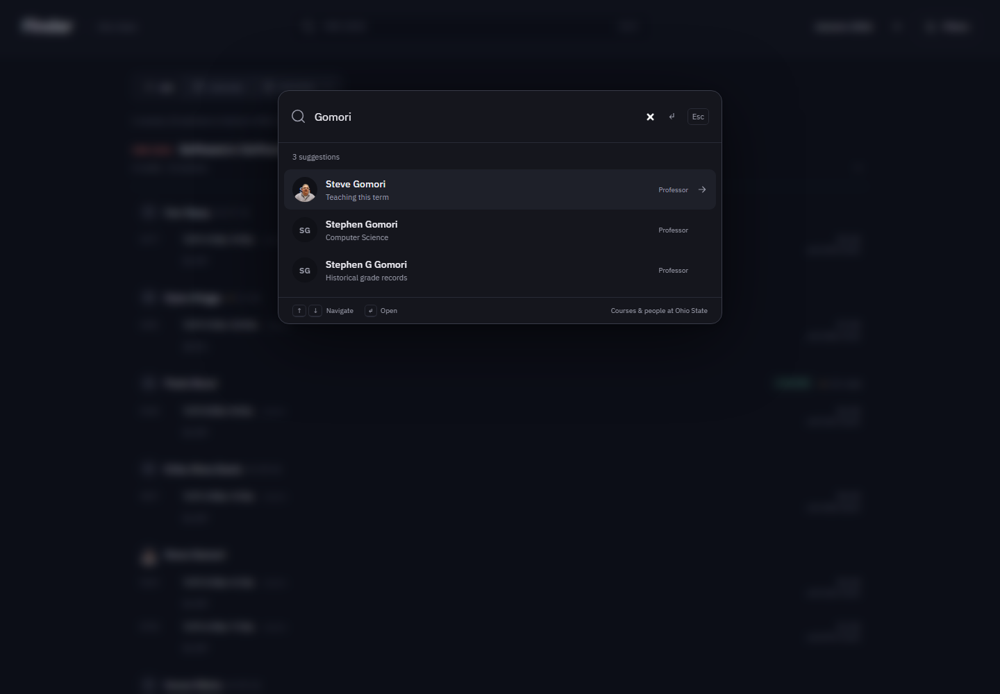

# Finder

Ohio State courses, professors, grades, and open seats.

**[Open Finder](https://enesyilmazcode.github.io/Finder/)**

## One search

Click the search field or press **Ctrl+K / Cmd+K**. Type a course number, course
title, subject, or professor. Suggestions tolerate small spelling mistakes and
partial words. Arrow keys navigate; Enter opens; Escape closes and returns focus.
Course suggestions show the title. Professor suggestions show a photo when an
OSU address and a verified photo are available, and initials otherwise.

Selecting a professor searches that person and keeps only sections naming them.
It does not promote unrelated instructors who share one part of a name. Selecting
a course searches that exact code. The term stays next to search; there is no
second search form in the filters.


## Compare, then open

Results group classes under their instructors, with ratings, available seat
counts, and historical course GPA where records match. Click an instructor or
section to open details. Grade history comes first: select a term, inspect the
letter-grade chart, expand the exact grade breakdown or compare terms. Courses
using S/U or pass marks show those outcomes instead of a misleading zero GPA.

Student reviews, methodology and supporting detail use progressive disclosure.
Copying a class number is a small labeled icon; **Save** adds the section to the
optional schedule. **Filters** opens a compact panel for days, time, availability,
ratings and GE requirements. List, calendar and saved schedule views share the
same data. Linked labs and recitations are preserved in registration packages.



On phones, details replace results and the close button returns to the selected
section. The palette, filters and scrollbars follow the system light/dark theme.
Transitions respect reduced-motion preferences.

## The records

Ohio State fulfilled public records request **27-0272** on November 4, 2026:
25 Excel workbooks, **Spring 2018 through Spring 2026**. Finder includes
92,242 distinct Columbus classes associated with 8,419 normalized instructor
names. SEI evaluation data is still pending.

Every source row reconciles to its enrollment total. EN (non-attendance) counts
as E for GPA; withdrawals and other non-letter marks stay outside the mean.
Whole classes under 10 students and classes taught by student instructors were
omitted by OSU. Team-taught outcomes are labeled. The files contain names without
emails, so matching uses full names and refuses ambiguous abbreviated matches.
These are past cohort outcomes, not predictions of an individual student's grade.

The global identity index is small. History is split by subject, fetched only
for a searched subject or an opened section. To rebuild from the original XLSX
attachments (Python standard library only):

```bash
python scripts/import-grade-records.py .local/grade-records
```

Original files remain preserved locally. The committed provenance records their
SHA-256 hashes, row counts and coverage. See [grade methodology](docs/osu-grades.md).

## Sources and network behavior

Finder runs on GitHub Pages, with no application server or build step. Ohio
State's class API serves live course and instructor information. GitHub jobs
snapshot RateMyProfessors ratings, Barrett's per-section seats, the course
catalog and the list of available OSU headshots. Grades come from the records
release. Filters work locally; seats are a dated snapshot and can change.

Opening the page is at most 36 requests across two hosts: 35 files from this repo
and the term list from `content.osu.edu`. The budget includes HTML, three stylesheets,
up to three font files, 24 modules, the ratings snapshot, two seat files and the favicon.

Opening search adds the local catalog, grade identity index and photo index.
Professor queries can make a debounced request to the OSU class API to discover
verified instructor addresses. Only matching people from the latest query can
enrich suggestions. Photos load from `opic.osu.edu` when OSU lists one. Class
searches request live sections and up to four subject grade archives for the
comparison list; other subjects load on opening a section. Rating course counts
load on first detail. Failures stay retryable and ambiguous identities are not
guessed. No third-party fonts, icon CDN, or external JavaScript is used.

The production site sends a page-view ping to the first-party analytics worker.
Local browser checks skip it. Schedules stay in this browser unless explicitly
shared from the optional schedule view.

## Run locally

```bash
python -m http.server 8000
```

Open <http://localhost:8000>. Run the offline suite with Node 22 and Python 3:

```bash
npm test
```

No npm dependencies or Python packages are required. Optional live tests run only
with `FINDER_LIVE=1`. Snapshot jobs refuse unexpectedly small or malformed data
instead of replacing a healthy snapshot.

## Repo layout

```
index.html            the whole page
css/finder.css        shared calendar, schedule and filter primitives
css/workspace.css     the workspace, command palette and responsive design
css/fonts.css         the three families, self hosted
css/stats.css         the /stats page
assets/fonts/         the woff2 files and their licenses
js/
  app.js              wiring, state, URL sync
  command-search.js   Ctrl/Cmd+K palette, live professor photo enrichment
  search-index.js     bounded fuzzy ranking and deliberate name matching
  icons.js            local SVG icons
  api.js              client for OSU's class API
  rank.js             merging, scoring, splitting results
  render.js           list view, grouped by instructor
  calendar.js         week grid
  schedule.js         saved sections, sharing and conflict detection
  generator.js        linked packages, conflict search and schedule scoring
  generator-render.js automatic builder controls and ranked choices
  detail.js           right pane
  filters.js          client-side filtering
  sort.js             ordering by rating, difficulty, seats or start time
  deeplink.js         the page state a link carries, and its section
  ratings.js          RMP snapshot and name matching
  grades.js           historical grades, full-name matching and subject archives
  headshots.js        which instructors have a photo, and the initials fallback
  seats.js            Barrett snapshot and the term guard
  trend.js            what moved between two seat snapshots
  courses.js          lazily loaded course index
  format.js           days, times, units, names
  hit.js              one page-view ping, skipped on localhost
  analytics.js        the one place the worker URL lives
  stats.js            the /stats dashboard
scripts/              the four snapshot jobs, and the records import
data/                 the snapshots, committed
docs/                 what OSU's API, Barrett's schedule and the records get wrong
tests/                node:test, zero dependencies
wireframes/           three layouts considered first
analytics/            the page-view counter, a Cloudflare Worker
stats/                the page that reads the counter
```

## Limits

- Seats are a morning snapshot, so a section can fill before you search.
- Barrett covers fewer sections than the API, so some rows never show seats.
- Back steps through searches and closes the section pane. Filter changes
  and the saved plan update the current entry rather than adding one.
- A shared schedule refreshes each section separately, so a long schedule makes
  several requests to Ohio State when it opens.
- Changing a filter clears whichever section you had selected.
- Columbus only, and only the three terms OSU's API exposes at a time.
- A section listed in two rooms of the same building at the same hour shows
  one of them.

Finder is not affiliated with or endorsed by The Ohio State University.

## License

MIT. See [LICENSE](LICENSE).
